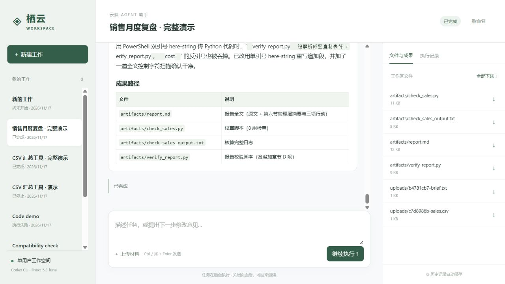

# 栖云 · 云端 Agent 助手工作台

把真实 Codex CLI 放进浏览器：多会话、后台执行、进度记录、上传材料、文件预览/下载、继续交流。面向可信单用户的本机 Docker 部署。



[实际验证记录与成果](evidence/README.md) · [自动验证](https://github.com/ZYJda/cloud-agent-workbench/actions) · [演示脚本](demo/DEMO.md)

## 快速开始

需要 Docker Engine / Docker Desktop（Linux containers）和 Docker Compose v2。

```sh
cp .env.example .env
# 编辑 .env，填入模型服务的 base URL、API key、model
docker compose up --build -d
docker compose logs -f
```

浏览器打开 http://localhost:8000 。停止服务：`docker compose down`。持久化数据在 `agent_data` 命名卷中，停止/重建容器不会丢失；不要使用 `down -v`，否则会删除历史和成果。

API 必须兼容 OpenAI Responses 协议，并支持客户端 function/custom 工具。`AGENT_BASE_URL` 使用供应商文档指定的接口根地址，不包含 `/responses`；并非所有供应商都需要 `/v1`。密钥只在服务端环境中使用；不要提交 `.env`、data/ 或原始凭据。

DeepSeek-V4-Pro 配置示例（[官方 Codex 接入说明](https://api-docs.deepseek.com/quick_start/agent_integrations/codex/)）：

```dotenv
AGENT_BASE_URL=https://api.deepseek.com
AGENT_API_KEY=replace-with-your-key
AGENT_MODEL=deepseek-v4-pro
```

修改配置后运行 `docker compose up -d --force-recreate` 使环境变量生效。本应用为每个会话生成独立的 CLI 配置，不修改用户的全局 Codex 配置。DeepSeek-V4-Pro 会自动加载官方文档所列的上下文窗口、工具格式及推理等级等能力配置，并使用本工作台自己的基础提示词。初次演示使用的考试模型为 `linext-5.3-luna`，旧凭据过期后的验证改用 DeepSeek。

## 使用

- 新建工作，输入需求，点击开始执行。每会话同一时刻只允许一个任务；最多两个会话并行，其他任务排队。
- 上传材料（每文件 20 MB）；文件进入该会话的 uploads/，同名文件自动加随机前缀，避免覆盖。
- 执行记录展示 CLI 的命令、工具输出和错误；最终答复显示在对话中。
- 文件与成果支持 UTF-8 文本预览、单文件下载、ZIP 下载（最多 100 MB、1000 个可见文件）。HTML 仅显示源码，不执行其中脚本。
- 继续发送会调用 `codex exec resume <thread_id>`，复用 CLI 历史与当前工作目录。
- 页面关闭不停止任务；重开恢复历史，SSE 重连按事件 ID 补读。服务重启会把运行/排队中的任务标记为 interrupted，保留已有文件，用户决定如何继续。

## 本地开发（非隔离，仅用于可信任务调试）

```sh
python -m venv .venv
# Linux/macOS: source .venv/bin/activate
# Windows: .venv\Scripts\Activate.ps1
pip install -r requirements.txt
npm install -g @openai/codex@0.169.0
uvicorn app:app --host 127.0.0.1 --port 8000
python -m unittest discover -s tests -v
```

可选环境变量：`CODEX_BIN`（CLI 可执行文件路径）、`DATA_DIR`、`RUN_TIMEOUT_SECONDS`（默认 900）、`MAX_CONCURRENT_RUNS`（默认 2，可设 1–4；考试 API 限流时建议 1）。仅启动一个 uvicorn worker；任务注册表与线程池是单进程设计。

## 设计与取舍

已参考 DeerFlow v2.0.0 官方源码进行分层改造，具体源码链接、采用范围及边界见 [架构说明](docs/ARCHITECTURE.md)。

浏览器 → FastAPI Gateway → RunManager → ContextPipeline → CodexDriver / ExecutionProvider → Codex CLI → 模型 API。SQLiteStore 与 EventStream 分别负责持久化和 SSE 回放，harness/ 不依赖 HTTP 框架。

SQLite 保存会话、任务状态和追加式事件；每会话独立 workspace 和 CODEX_HOME，后续交流用 CLI 自带的 resume。SSE 直接读取已落盘事件，重连无需依赖内存缓存。任务以排队、执行、完成、失败、取消、中断区分；取消和超时结束进程树，失败不会伪装成完成。配置缺失和 CLI 启动失败也会保留任务记录。

上传材料由中间件显式注入上下文；文件写完后才原子发布。每轮成功后登记 artifacts/ 成果的路径、大小、SHA-256 和 run_id，保留元数据历史供核对；文件内容本身仍不做版本备份。

没有实现另一个聊天模型或自制工具调用循环：文件操作、命令执行、推理和续聊均来自真实 Codex CLI。网页只负责调度、呈现和持久化。通过固定 CLI 版本、关闭 web_search 和子代理工具，缩小兼容面。参考 [Codex 非交互模式](https://developers.openai.com/codex/noninteractive) 和 [配置参考](https://developers.openai.com/codex/config-reference)。

实际联调发现两项协议差异：考试接口拒绝 namespace 类型的子代理工具声明，因此设置 `[agents].enabled=false`；显式 `reasoning.effort=medium` 会被该模型拒绝，因此使用服务默认推理设置。没有篡改模型结果，也没有用普通聊天响应冒充 CLI 执行。

## 安全边界与已知限制

- 单用户可信工作区，无登录，Compose 仅绑定 127.0.0.1。不要直接暴露公网。HTTP 文件路由拒绝路径穿越、隐藏文件和符号链接；不代表对恶意 Agent 的安全隔离。
- CLI 在容器内使用 bypass approvals/sandbox 以完成无人值守任务；容器以非 root 运行、移除 capabilities、限制资源，不挂载 Docker socket 或宿主目录。所有会话共享一个容器和用户，因此会话目录是逻辑隔离，不是恶意代码安全边界。CLI 能读取其进程中的 API key。若要运行不可信材料，需独立执行容器和凭据代理，这是后续工作。
- 不支持 Chat Completions-only / Anthropic-only 服务；应换兼容 CLI 或增加经过验证的协议适配，不能只改 URL。
- 文本/CSV/代码任务开箱可用；扫描 PDF、Office 等材料的解析依赖 CLI 可用工具，目前没有预装 OCR/Office。二进制成果可下载。
- 没有自动重试整个任务（避免重复副作用）、执行快照、文件版本历史和磁盘总配额；文件被 Agent 修改后下载的是当前版本。
- 运行记录可能较大，当前未做分页 UI/日志轮转。单次运行日志只供可信用户查看。

## 演示与验证

见 [demo/DEMO.md](demo/DEMO.md) 的两类任务、多会话及后续修改流程。`tests/test_app.py` 是离线回归测试，模拟 CLI 事件，不冒充真实模型结果。真实模型、浏览器、Docker 和重启验证会单独记录在 evidence/ 中。
