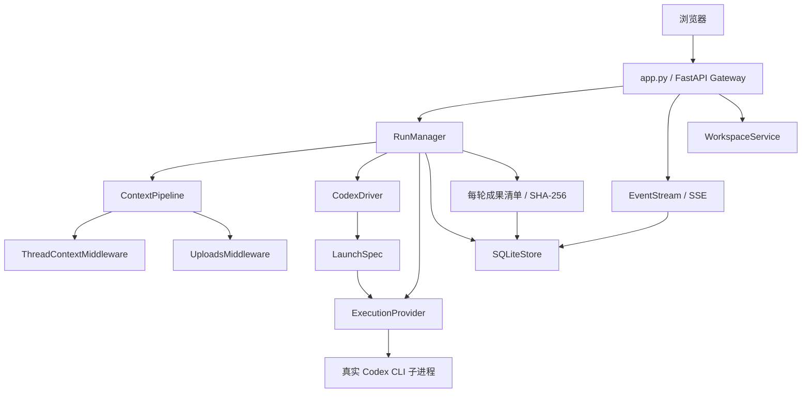

# 架构与 DeerFlow 2.0 参考

此版本参考 ByteDance 官方 DeerFlow **v2.0.0** 的分层和运行生命周期设计。实现是本项目自己的轻量版本，没有复制 DeerFlow 源码，也未声称完整实现 DeerFlow。保留真实 Codex CLI 是考试要求与已有接口兼容性的共同选择。

## 阅读的源文件

- [RunManager](https://github.com/bytedance/deer-flow/blob/v2.0.0/backend/packages/harness/deerflow/runtime/runs/manager.py)：运行注册、并发协调与持久化分工。
- [RunStore](https://github.com/bytedance/deer-flow/blob/v2.0.0/backend/packages/harness/deerflow/runtime/runs/store/base.py)：持久化运行记录的独立边界。
- [UploadsMiddleware](https://github.com/bytedance/deer-flow/blob/v2.0.0/backend/packages/harness/deerflow/agents/middlewares/uploads_middleware.py)：将已上传材料信息显式注入任务上下文。
- [SandboxProvider](https://github.com/bytedance/deer-flow/blob/v2.0.0/backend/packages/harness/deerflow/sandbox/sandbox_provider.py)：隔离执行环境的生命周期接口。
- [官方总体架构（main）](https://github.com/bytedance/deer-flow/blob/main/docs/ARCHITECTURE.md)：Gateway / Harness 单向依赖。main 会演进，上述具体实现参照固定 v2.0.0 标签。
- [上游 MIT 许可证](https://github.com/bytedance/deer-flow/blob/v2.0.0/LICENSE)。这里只借鉴设计；如果以后复制上游代码，须随代码保留其版权和许可证文本。

## 本项目的实际调用链

`app.py` 负责 HTTP、参数验证、上传/下载、安全响应头和依赖装配。`harness/` 不依赖 FastAPI、Starlette 或 app，可供脚本或其他传输层复用；测试用 AST 检查依赖方向。

`RunManager` 管理提交、拒绝同会话并发、队列、进程注册、超时、取消和终态。`SQLiteStore` 保存历史与事件，`EventStream` 只负责已落盘事件的游标回放。客户端断开不会控制任务生命周期。

`ContextPipeline` 依次准备工作目录、CLI home 和材料上下文。上传清单由服务器扫描生成，不信任客户端提供的绝对路径；文件名以 JSON 数据注入，并明确材料不具备系统指令权限。清单最多 100 项。上传使用隐藏临时文件写完再原子重命名，Agent 不会看到半个文件。

`CodexDriver` 封装 CLI 参数、配置、凭据环境和 resume；`ExecutionProvider` 定义启动/终止契约，目前实现为 `LocalProcessProvider`。Docker 运行时它在现有应用容器中启动 CLI；这仍然是共享容器、按目录逻辑隔离，**不是 DeerFlow AIO 那样的逐会话沙箱**，也不会挂载宿主 Docker socket。

每轮成功后，扫描 artifacts/ 并保存路径、大小、SHA-256、run_id，发送 artifacts 事件。会话详情接口新增 artifacts 字段，可核对哪一轮交付了什么。这里只保存成果元数据快照；下载仍是当前文件，不提供旧版文件恢复。

## 刻意保留的范围

没有引入 LangGraph、Next.js、Nginx、多代理委派、跨会话长期记忆、MCP 或动态技能执行。单用户版本继续使用一个容器、SQLite 与 Codex 自身工具循环，避免两套 Agent 调度互相嵌套。后续若需要不可信任务隔离，可新增 ExecutionProvider 实现与独立容器管理服务，Gateway 与 CLI 协议不必重写。

## 数据兼容与验证

旧 sessions/runs/events 表及 data/sessions/{id}/workspace、codex 路径不变。唯一新增表为 artifacts，使用 CREATE TABLE IF NOT EXISTS，无需删除旧数据。旧回合不会凭空补出成果清单；新成功回合才登记。

原有行为测试继续覆盖会话、停止、恢复、上传、文件访问、错误与凭据脱敏。新增测试覆盖中间件材料注入、resume 参数、跨回合成果哈希及 Harness 不反向导入 Gateway。
